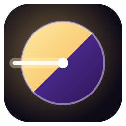
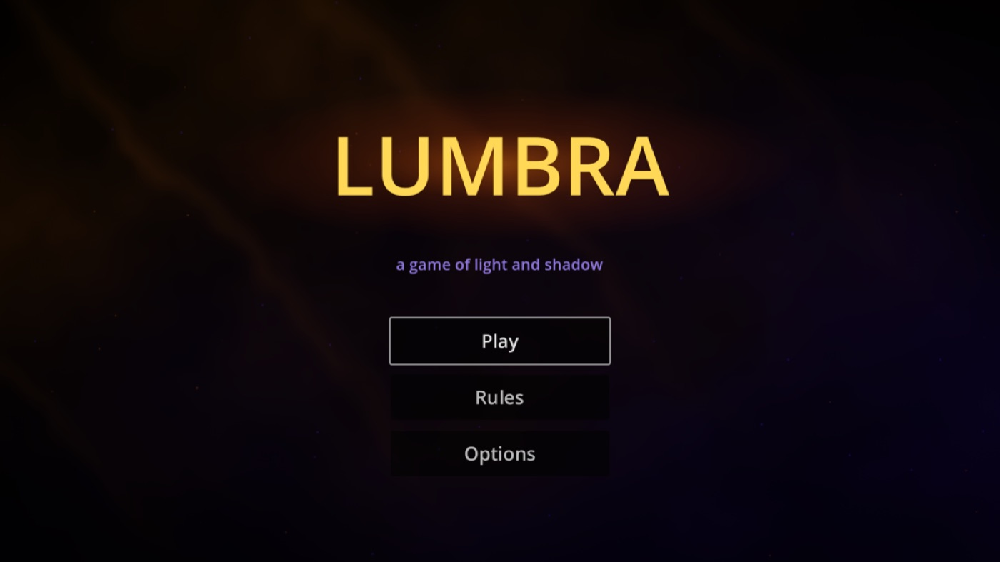
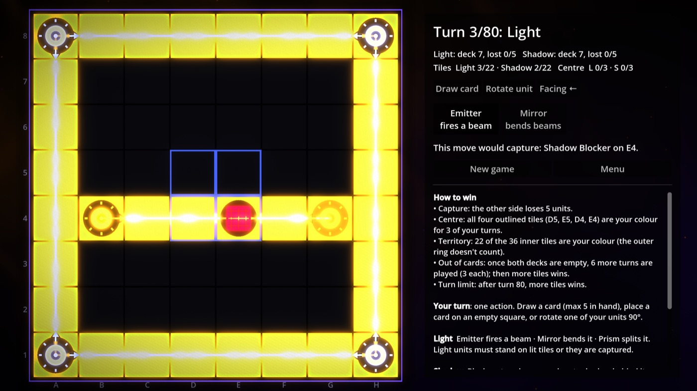
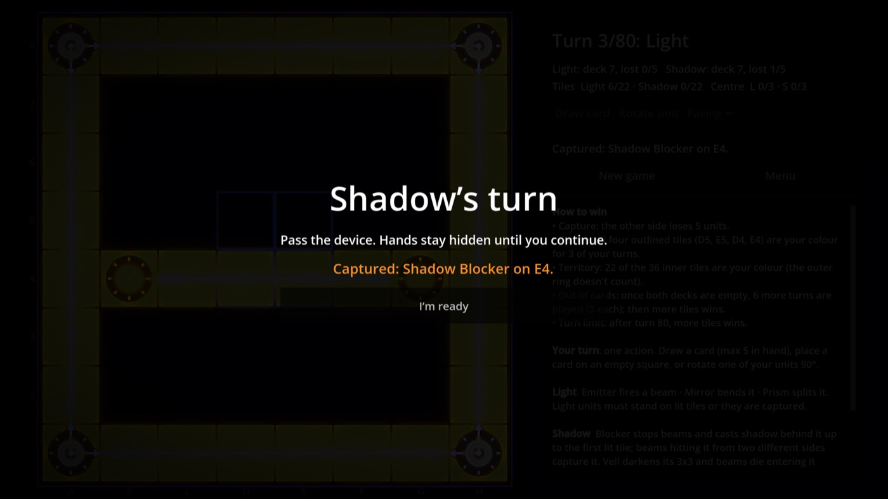

<p align="center">
  
</p>

<h1 align="center">Lumbra</h1>

<p align="center">
  <em>A pass-and-play tactics game of light and shadow on an 8×8 board.</em><br>
  Bend beams, cast shadows, and fight for the centre — two players, one device.
</p>

<p align="center">
  
  
  
</p>

<p align="center">
  
  
</p>

**Contents:** [Play](#-for-players) · [Rules](#rules) · [Controls](#controls) · [Develop](#-for-developers) · [Project layout](#project-layout) · [Tuning](#tuning-the-game) · [Testing](#testing-and-balance) · [Exporting](#exporting)

---

## 🎮 For players

Light and Shadow share one board. **Light** places Emitters, Mirrors and Prisms to throw beams across the board. **Shadow** places Blockers and Veils to stop them and darken the board. Every move instantly recalculates where light falls — and any piece standing in the wrong place is captured.

Four neutral **corner emitters** light the edges of the board from the start. Light always moves first. After each move the device is passed to the other player; your hand stays hidden behind a "pass the device" screen.

### Rules

#### Your turn

Do **one** action:

- **Draw** a card (you can hold up to 5), **or**
- **Place** a card from your hand on an empty square, choosing which way it faces, **or**
- **Rotate** one of your pieces a quarter turn clockwise.

You can't place a piece where it would be captured immediately — the move preview shows this in red before you click.

#### The pieces

| Piece | Side | Deck | What it does |
|---|---|---|---|
| **Emitter** | Light | 2 | Fires a beam in the direction it faces. |
| **Mirror** | Light | 5 | Bends a beam 90°. Two orientations: `/` and `\`. |
| **Prism** | Light | 3 | Facing *across* a beam: the beam goes straight on **and** branches off the way the Prism faces. Facing *along* a beam: it splits into both sideways directions. |
| **Blocker** | Shadow | 5 | Stops beams and casts a shadow behind itself, up to the first lit square. |
| **Veil** | Shadow | 5 | Darkens the 3×3 area around it (its own square included). Beams die as soon as they enter the darkness. |
| **Corner emitter** | Neutral | — | Fires along both edges from its corner. Can't be moved, rotated or captured, and its beams pass straight through Veil darkness. |

#### Light, shadow and dim squares

After every move each square becomes one of:

- **Light** (gold) — a beam passes through or ends on it.
- **Shadow** (violet) — inside a Veil's darkness, or in a Blocker's shadow.
- **Dim** (grey) — neither.

Only the **inner 6×6** squares count as territory. The outer ring is lit by the corner emitters from the start, so it doesn't count for either side.

#### Captures

- **Light pieces** must stand on a lit square. If a move leaves one in the dark, it is captured.
- A **Blocker** is captured when beams hit it from **two different sides** at once.
- A **Veil** whose darkness touches a **centre square or a corner** is captured when beams enter its darkness from **two different directions**. Corner-emitter beams don't count. Other Veils can't be captured by beams.
- Captures can chain: removing a Mirror can plunge more pieces into darkness. **Your own pieces can be captured by your own move.**

Dashed violet bars on a Blocker or Veil show which sides have already been hit — one more side and it's gone.

#### How to win

Checked after every move, in this order:

1. **Capture** — the other side has lost **5** pieces. (If both reach 5 on the same move, the player who moved loses.)
2. **Centre** — all four outlined centre squares (**D5, E5, D4, E4**) are your colour at the end of **3** of your turns in a row.
3. **Territory** — **22** of the 36 inner squares are your colour.
4. **Out of cards** — once both decks are empty, **6** more turns are played (3 each), then the side with more territory wins.
5. **Turn limit** — after turn **80**, the side with more territory wins.

For 4 and 5, a tie goes to the side that lost fewer pieces; if that's equal too, it's a draw.

<p align="center">
  
</p>

### Controls

| Action | How |
|---|---|
| Place a piece | Click a card in your hand, set **Facing** (click it to turn), then click an empty square. |
| Preview a move | Hover a square with a card selected — you see the piece, where the light would go, and anything it would capture (pulsing red). |
| Rotate a piece | Toggle **Rotate unit**, then click one of your pieces. Hovering previews the rotation. |
| Draw | **Draw card**. |
| Next player | Pass the device and press **I'm ready**. |
| Menu / restart | **Menu** or **New game** in the side panel. |
| Back (in Rules / Options) | **Esc** |

### Options

Fullscreen, screen effects (vignette and film grain), piece animations, sound effects and ambient sound. Options are saved between sessions.

### Tips

- Watch the **preview hint** under your hand: it tells you what a move would capture before you commit.
- A Mirror placed on the lit edge ring catches a corner beam and sends it into the board.
- A single centre Veil can claim all four centre squares — Light needs beams from two directions to break it.
- Rotating is a full move. Sometimes turning one Mirror is worth more than placing a new piece.

---

## 🛠 For developers

### Requirements

- **[Godot 4.6](https://godotengine.org/download)** (developed and tested on 4.6.1, Forward+ renderer with HDR 2D).
- Export templates for 4.6.1 if you want to build executables.
- Python 3 only if you want to regenerate the placeholder sounds.

### Run it

Open `project.godot` in Godot and press **F5**, or from a terminal:

```bash
godot --path .
```

(On macOS the binary is `/Applications/Godot.app/Contents/MacOS/Godot`.)

### Project layout

```
scripts/core/    Pure game logic — no scene nodes needed
  rules.gd         every gameplay number (decks, limits, win conditions)
  unit.gd          piece data: kind, faction, facing, mirror/prism maths
  board_state.gd   8×8 grid of units, deep copy for previews
  light_engine.gd  stateless light solver: beams, darkness, shadows, captures
  turn_manager.gd  turn state machine, actions, win checks, move previews
scripts/board/   How the board is drawn
  look.gd          every colour, size and animation time
  board_view.gd    composes the layers, keeps one view per piece, previews
  tile_layer.gd    board plate, tiles, centre outline, A–H / 1–8 labels
  beam_layer.gd    beams as UV quads for the beam shader
  hit_marker_layer.gd  dashed bars on hit sides of Blockers / Veils
  unit_view.gd     one piece: sprite, plate, emitter arrows, animations
scripts/ui/      hud, card_button, handoff_screen, game_over_screen, start_menu, settings
scripts/fx/      sound.gd (all audio; every button clicks automatically)
scripts/main.gd  thin controller wiring TurnManager ↔ board ↔ HUD ↔ overlays
scenes/          one scene per component (units/, board/, ui/, fx/, main.tscn)
shaders/         beam.gdshader, background.gdshader, post_fx.gdshader
assets/          units/ (128 px white sprites, tinted per side), audio/ (placeholder WAVs)
tests/           blocker_test.gd, balance_sim.gd
tools/           gen_sfx.py (sound generator)   docs/  README images
```

`docs/` and `tools/` contain a `.gdignore`, so Godot neither imports nor exports them.

### How a move flows

```
click / hover ─▶ main.gd ─▶ TurnManager.try_place / try_rotate / try_draw
                                   │
                                   ├─ LightEngine.compute(board)        recompute all light
                                   ├─ TurnManager.settle(board)         remove captures until stable
                                   ├─ board_changed  ─▶ BoardView.refresh (animations, sounds)
                                   ├─ _check_victory ─▶ game_over
                                   └─ handoff_requested ─▶ HandoffScreen (after the animations)
```

The light is recomputed from scratch after every action, so there is no incremental state to get out of sync. Previews call the same code on `board.copy()`, so what the preview shows is exactly what the move will do.

### Scene layers

| Layer | Scene | Purpose |
|---|---|---|
| −1 | `fx/background.tscn` | Animated light/shadow backdrop |
| 0 | `board/board_view.tscn` | Tiles → Beams → HitMarkers → Units → Preview (gets HDR glow) |
| 1 | `fx/post_fx.tscn` | Vignette and film grain |
| 2 | `ui/hud.tscn` | Side panel |
| 20 / 30 / 40 | handoff / game over / start menu | Full-screen overlays |

### Tuning the game

| To change… | Edit |
|---|---|
| Decks, hand size, win conditions, turn limits | `scripts/core/rules.gd` |
| Colours, sizes, animation and handoff timings | `scripts/board/look.gd` |
| Beam pulse speed and glow | uniforms in `shaders/beam.gdshader` |
| Background, vignette, grain | `shaders/background.gdshader`, `shaders/post_fx.gdshader` |
| Sound volumes | `VOLUME_DB` in `scripts/fx/sound.gd` |
| Sounds | replace the files in `assets/audio/` (keep the names), or edit and rerun `python3 tools/gen_sfx.py assets/audio` |
| Sprites | replace the PNGs in `assets/units/` (white on transparent, 128 px) |

The in-game rules panel is built from `rules.gd`, so changing a number there updates the text too.

### Adding a new piece

1. Copy a scene in `scenes/units/` and swap its sprite.
2. Add a value to `Unit.Kind`, plus its `Unit.NAMES` / `Unit.HINTS` entry.
3. Register the scene in `UNIT_SCENES` in `board_view.gd`.
4. Teach `LightEngine.compute()` how beams interact with it (and `find_violations()` how it gets captured).
5. Add it to a deck in `rules.gd`, and describe it in `HUD.rules_text()`.
6. Run the tests and the balance simulator.

### Testing and balance

Headless rule test (expects `crush {27: true}` and `violations [(3, 3)]`):

```bash
godot --headless --path . -s tests/blocker_test.gd
```

Self-play balance simulator — two bots play through the real `TurnManager`:

```bash
godot --headless --path . -s tests/balance_sim.gd -- 100 1 greedy greedy
```

Arguments: number of games, first seed, Light bot, Shadow bot (`greedy` or `random`). Each game prints one line:
`GAME,seed,winner,reason,turns,light_lost,shadow_lost,light_tiles,shadow_tiles`. With the current rules, greedy vs greedy splits roughly 47 / 53 (Light / Shadow) and games last about 21 turns. Re-run it after changing anything in `rules.gd` or `light_engine.gd`.

### Exporting

1. Install the 4.6.1 export templates (**Editor → Manage Export Templates**).
2. **Project → Export**. A *Windows Desktop* preset is included; add macOS or Linux presets as needed.
3. In the preset's **Resources** tab, set the exclude filter to `tests/*` so the test scripts aren't shipped.

Or headless:

```bash
mkdir -p build && godot --headless --path . --export-release "Windows Desktop" build/Lumbra.exe
```

`build/` is ignored by git. The app icon is `icon.svg`. Saved options live in Godot's user folder (`user://settings.cfg`, e.g. `~/Library/Application Support/Godot/app_userdata/Lumbra/` on macOS).

### Known limitations

- Pass-and-play only — no AI opponent or online play yet.
- Sounds are synthesized placeholders.
- The web export is untested; the HDR glow may look flatter in browsers.

---

## Credits

Made by **Jabber Bin Kibria** with [Godot Engine](https://godotengine.org).

## License

No license has been chosen yet, so all rights are reserved by the author. Add a `LICENSE` file before accepting contributions.
